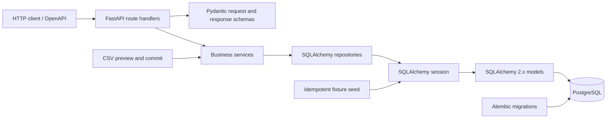

# StockFlow Backend Architecture

**Scope:** FastAPI/PostgreSQL backend for the connected React frontend, including catalogue, inventory, dashboard, replenishment, movement history, and CSV snapshot import.

## Runtime layers

- `app/api/routes/` defines versioned HTTP endpoints and stays thin; it validates input, calls a service, and serializes a response.
- `app/schemas/` owns request/response validation and pagination shapes.
- `app/services/` owns product/store rules, SKU indexing, heap-based replenishment priority, CSV validation, stock validation, idempotency, and transaction boundaries.
- `app/repositories/` owns SQLAlchemy query and persistence operations used by services.
- `app/models/` declares relational tables, constraints, relationships, and indexes.
- `app/db/` configures SQLAlchemy sessions and contains the explicit seed command.
- `app/core/config.py` reads environment configuration using Pydantic Settings.
- `alembic/` contains versioned migrations. Runtime startup never creates tables automatically.
- `tests/` uses TestClient and an explicitly isolated PostgreSQL test database.

## Transaction boundary

Each successful product create, product/store update, soft delete, or inventory movement uses one SQLAlchemy `Session.begin()` transaction. The stock service verifies active product and store records, locks the matching product/store balance with PostgreSQL `SELECT ... FOR UPDATE`, validates the resulting stock, updates the balance, inserts a movement, and inserts an activity row before committing. Database errors and domain failures roll back the transaction. The test suite includes a two-session oversell race and a database trigger failure after the balance/movement writes.

The movement lock serializes writes to one balance. Distinct product/store pairs can proceed independently. Movement writes require an `Idempotency-Key`; a payload hash and movement reference are committed atomically with the stock operation. Exact retries return the original movement; conflicting reuse returns 409. CSV commit keys and result summaries are persisted transactionally as well.

CSV import uses UTF-8 input, required `SKU`, `Store`, and `Quantity` columns, optional `Reorder Level`, active SKU/store reference validation, duplicate pair detection, and row-level preview errors. Commit is all-or-nothing: any rejected row aborts the batch. Accepted rows set absolute snapshot quantities and emit store-scoped `csv_import` activity rows in the same database transaction; they do not fabricate stock movement events.

Replenishment returns active balance rows at or below reorder level using a min-heap keyed by largest deficit first, higher reorder level, SKU, store code, then numeric IDs. Suggested quantity restores to twice the reorder level. No demand forecasting is inferred.

## Product/store lifecycle

- Creating a product creates quantity-zero balances for every currently active store. Its optional `default_reorder_level` initializes each new balance; it defaults to zero.
- Creating a store creates quantity-zero balances for every active product, copying that product's current reorder level from an existing balance (or zero if none exists).
- Product edits do not change inventory quantities or reorder thresholds.
- DELETE on a product or store is a soft delete (`is_active=false`) so historical balances and activity remain referentially valid. Inactive entities are omitted from normal lists and movement operations.

These initialization/lifecycle rules are Chunk 1 implementation decisions, not inferred existing frontend behavior.

## Configuration and local operation

`DATABASE_URL` is required, normally loaded from `backend/.env`. `.env.example` contains placeholders and local CORS origins. SQLAlchemy connections set session timezone to UTC. `API_V1_PREFIX` defaults to `/api/v1`; CORS origins are configurable through `CORS_ORIGINS`.

From `backend/`, install `requirements-lock.txt`, run `alembic upgrade head`, then `python -m app.db.seed_data`. Start with `uvicorn app.main:app --reload`. `/health` runs `SELECT 1` and reports database availability; FastAPI publishes OpenAPI at `/openapi.json` and Swagger UI at `/docs`.

## Security and deployment boundary

This is an academic MVP. No user/role model or authentication/authorization is present; CORS is not access control. Tenant isolation, rate limiting, production secret storage, deployment topology, backups, and observability are not implemented. Keep it on a trusted local/demo network. No live deployment has been verified.
